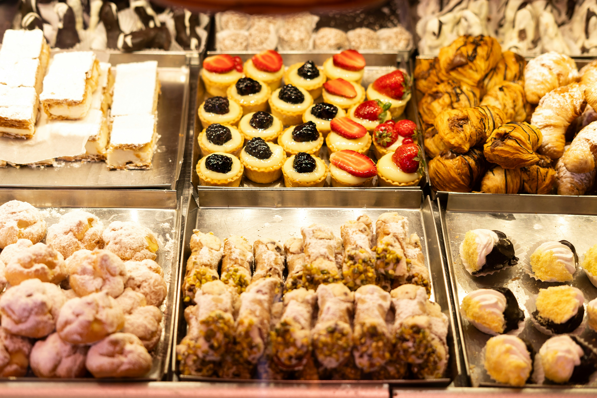
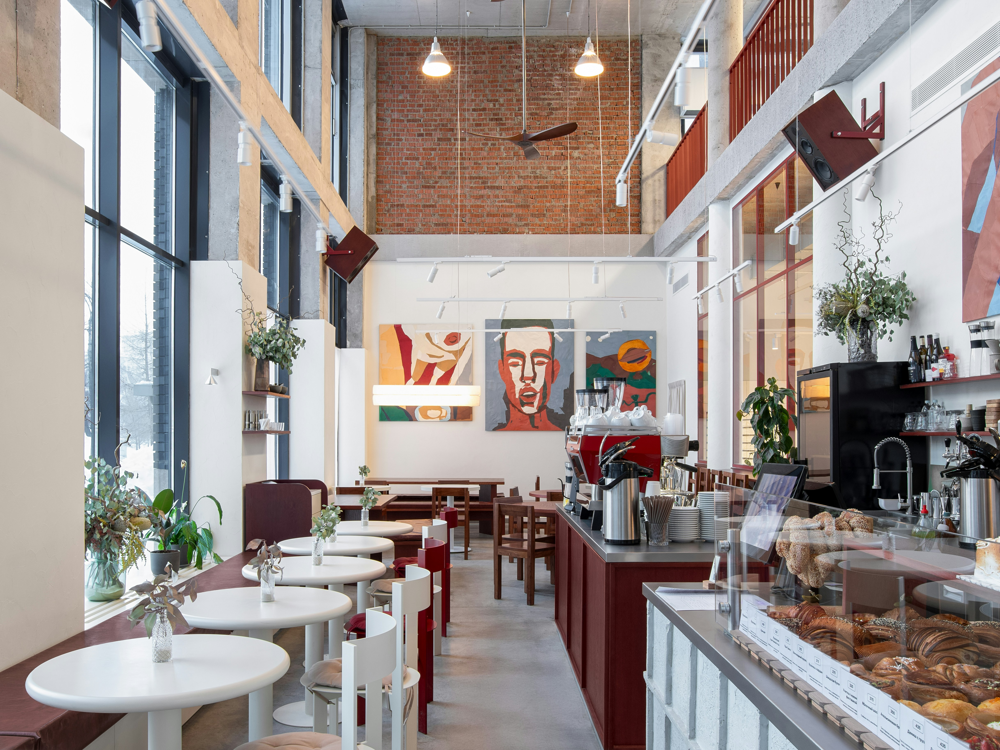

# Mood board: Leipomo-kahvila Voisilmä

## Feeling

- Warm – Cream and forest-green colours create a welcoming bakery atmosphere.
- Fresh – The clean layout represents freshly baked products and a fresh start to the day.
- Friendly – Simple navigation and readable text make the website easy to use for everyone.

## Colours

| Name | Hex | Used for |
|---|---|---|
| Forest Green | #1F3D2B | Header, footer and headings |
| Cream | #F7F3E8 | Main background |
| Mustard Yellow | #C8902E | Navigation highlights and decorative details |
| White | #FFFFFF | Menu cards and form backgrounds |
| Light Border | #D8D2C3 | Borders and separators |

Main text on background: 10.76 : 1
-(Forest Green on Cream)
The forest-green text on the cream background has a contrast ratio above 4.5:1.
I also checked the text colours in dark mode. The tested text and background
combinations meet the requirement of at least 4.5:1.

## Fonts

- Headings: Georgia, serif – Gives the bakery a traditional and welcoming appearance.
- Body text: Arial, sans-serif – Simple, clean and easy to read.

## References

### Logo and visual identity

The logo represents the bakery's identity and is used in the website header.

### Reference websites

1. https://www.fazer.com/
2. https://www.paulig.com/
3. https://www.ph7.fi/

### Reference images

Source: [Unsplash – Bakery display](https://unsplash.com/photos/a-display-case-filled-with-lots-of-different-types-of-pastries-n4-NW-jZcoQ)

Source: [Unsplash – Cafe interior](https://unsplash.com/photos/modern-cafe-interior-with-artwork-and-seating-6lpikFFzyd4)